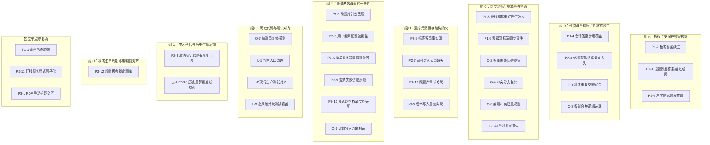

# EasyExam 全仓深度审查｜完整问题清单

- **审查日期**：2026-10-20
- **仓库**：[https://github.com/liuchangchxy/easy-exam](https://github.com/liuchangchxy/easy-exam)
- **审查基线**：`main` / `65b99726e8be1c60dcb4d6a015fba0cbb686e969`
- **相关工作**：PR #54（UI/UX v2）、PR #55（题库内容管理）、PR #58（全链路缺陷修复）均已合并；Issue #57 已关闭
- **审查范围**：前端、后端、数据库、题库、导入、练习、模考、错题、FSRS、多用户、离线同步、AI、测试与冗余架构
- **证据等级说明**：
  - **源码确认**：通过静态代码调用链确认风险条件；
  - **待复现**：需要并发/异常/真实数据场景验证；
  - **复杂性确认**：代码冗余或责任重叠可由结构确认。
  > 本文件为上一轮静态审查报告的完整归档与输入底表，未追加动态复现结果。

---

## 0. 问题总览

| 级别 | 数量 | 核心领域 |
|---|---|---|
| **P0** | 0 项 | - |
| **P1** | 6 项 | 安全、考试完整性、答题一致性、同步可靠性 |
| **P2** | 13 项 | 业务正确性、数据约束、配置、AI、迁移 |
| **P3** | 1 项 | 导入交互 |
| **△ 条件性风险** | 2 项 | AI 并发接受、FSRS 历史评级 |
| **过度工程化 / 防御性编程** | 8 个治理目标 | 与前述缺陷部分重合，不重复计入故障数 |
| **横向遗留** | 3 类 | 旧版架构、入口与测试覆盖缺口 |

---

## 1. P1 优先修复清单

### P1-1 密码哈希进入用户 API 响应
- **代码位置**：[`backend/app/infrastructure/db/repositories/user_repository.py:25-28`](file:///backend/app/infrastructure/db/repositories/user_repository.py#L25-L28)；[`backend/app/api/routes/auth.py:14-19,40-42`](file:///backend/app/api/routes/auth.py#L14-L42)
- **根因**：数据库用户对象带 `password_hash`，注册及 `/auth/me` 返回时未明确转换为无敏感字段的响应结构。
- **影响**：密码哈希暴露在 API 响应中，且可能进入浏览器缓存或持久化存储。
- **最简修复**：注册和 `/auth/me` 使用统一的公开用户响应对象（如 Pydantic `UserResponse`），仅包含必要字段，严格剔除 `password_hash`。
- **验收标准**：API 返回及浏览器客户端存储均不含 `password_hash` 字段。
- **证据等级**：源码确认（建议以响应级测试固定约束）。

### P1-2 模考答案遮蔽可以通过其他练习会话绕过
- **代码位置**：[`backend/app/application/practice_service.py:185-211`](file:///backend/app/application/practice_service.py#L185-L211)
- **根因**：答案隐藏依据请求的当前练习会话类型是否为 `EXAM`，而不是依据当前用户是否正在参加涉及该题目的有效模考；同一用户的普通练习会话仍能读取该题目完整版本。
- **影响**：模考考生可通过并行打开普通练习入口查询考题标准答案，破坏考试公平性。
- **最简修复**：在统一题目读取/响应边界检查该用户当前的有效模考状态；对处于活动模考中的受保护题目，在所有练习与详情接口统一遮蔽标准答案与官方解析。
- **验收标准**：同一用户在进行模考期间，经普通练习、题目版本历史等入口均无法读出受保护题答案。
- **证据等级**：源码确认。

### P1-3 错题接口绕过题库成员校验，并暴露答案
- **代码位置**：[`backend/app/infrastructure/db/repositories/practice_repository.py:441-462`](file:///backend/app/infrastructure/db/repositories/practice_repository.py#L441-L462)
- **根因**：查询错题时返回标准答案，未将题库成员关系（`question_bank_members`）纳入授权约束。
- **影响**：模考中可借错题列表取得答案；被移出共享题库的用户仍可能读取历史错题对应的受限题目内容。
- **最简修复**：错题读取关联当前题库成员权限；在模考保护期间不返回答案；错题列表默认只返回展示所需内容。
- **验收标准**：撤销成员权限后无法读取题目；模考保护期间错题入口不能暴露答案。
- **证据等级**：源码确认。
- **同根因归并**：与 P1-2、P2-4 同属授权与内容披露规则散落。

### P1-4 并发提交可覆盖已保存的会话答案
- **代码位置**：[`backend/app/application/practice_service.py:128-149`](file:///backend/app/application/practice_service.py#L128-L149)；[`backend/app/infrastructure/db/repositories/practice_repository.py:202-213`](file:///backend/app/infrastructure/db/repositories/practice_repository.py#L202-L213)
- **根因**：事务外取得的会话 `answers_json` 快照被整列写回；并发请求缺少基于最新状态的原子合并机制。
- **影响**：多设备或多个并发作答提交可能互相覆盖，作答明细与会话汇总产生不一致。
- **最简修复**：在同一数据库写事务中读取并原子合并最新答案，避免以旧快照覆盖最新提交。
- **验收标准**：两个设备/标签页同时提交不同题目的作答，最终均被完整保留；答题明细与会话汇总保持一致。
- **证据等级**：源码确认竞争窗口；待并发测试覆盖。

### P1-5 离线重试可能重复生成题目版本
- **代码位置**：[`frontend/src/views/PracticeViewV1.vue:1437-1512`](file:///frontend/src/views/PracticeViewV1.vue#L1437-L1512)；[`backend/app/infrastructure/db/repositories/question_repository.py:362-447`](file:///backend/app/infrastructure/db/repositories/question_repository.py#L362-L447)
- **根因**：前端重试非幂等的编辑请求；服务端每次成功编辑均无条件创建新版本。
- **影响**：服务端处理成功但客户端网络超时未收到回执时，客户端自动重试将导致生成重复的题目版本和错乱历史。
- **最简修复**：对题目编辑建立最小幂等依据（如请求唯一 Client Request ID 或 `base_version_number` 严格校验），禁止结果不明时无脑自动重试，交由用户确认。
- **验收标准**：模拟服务端提交成功但响应在网络层丢失，重试后仅创建单一题目版本。
- **证据等级**：源码确认风险窗口；待异常注入测试复现。

### P1-6 秒级时间游标会漏掉同秒产生的同步事件
- **代码位置**：[`backend/app/infrastructure/db/connection.py:137-145`](file:///backend/app/infrastructure/db/connection.py#L137-L145)；[`backend/app/infrastructure/db/repositories/practice_repository.py:772-777`](file:///backend/app/infrastructure/db/repositories/practice_repository.py#L772-L777)
- **根因**：事件时间精度为秒，增量同步查询采用严格 `created_at > cursor`；若同秒生成的事件跨分页边界，分页截断后同一秒未读完的记录后续将永久无法被查出。
- **影响**：跨设备增量同步存在永久漏事件的系统性漏洞。
- **最简修复**：以严格单调递增的自增事件 ID（`id > cursor`）作为同步游标，按 ID 排序与分页，彻底解耦对时间戳精度的依赖。
- **验收标准**：同秒内连续生成超过一页容量的同步事件，分批同步后无重复、无遗漏。
- **证据等级**：源码确认。

---

## 2. P2 真实业务与数据正确性清单

### P2-1 跨题库学习计划丢题
- **代码位置**：[`backend/app/domain/learning/study_plan.py:47-107`](file:///backend/app/domain/learning/study_plan.py#L47-L107)
- **根因**：一日学习计划包含多个题库时，仅保存了首道题对应的 `bank_id`；后续按该题库启动会话，导致其他题库题目被静默过滤。
- **最简修复**：按题库对任务题目进行明确分组生成可执行子任务，前端按实际题库分组启动。
- **证据等级**：源码确认。

### P2-2 标签存在两套权威数据源
- **代码位置**：[`backend/app/infrastructure/db/repositories/bank_repository.py:164-200`](file:///backend/app/infrastructure/db/repositories/bank_repository.py#L164-L200)
- **根因**：`knowledge_tags` 表与 `question_versions.tags_json` 同时持有标签语义，重命名或删除未能统一保持一致。
- **最简修复**：选定单一标签权威存储表示，统一读写边界，消除两份独立分叉的标签状态。
- **证据等级**：源码确认。

### P2-3 草稿同步无法表达清空答案和取消标记
- **代码位置**：[`backend/app/infrastructure/db/repositories/practice_repository.py:326-392`](file:///backend/app/infrastructure/db/repositories/practice_repository.py#L326-L392)
- **根因**：空答案在智能合并中被直接忽略；标记合并采用集合并集，缺少主动删除语义。
- **最简修复**：明确全量覆盖替换或增量版本语义，支持显式清空作答与取消题目标记，杜绝模糊推测。
- **证据等级**：源码确认。

### P2-4 冲突信息查询权限未闭合
- **代码位置**：[`backend/app/infrastructure/db/repositories/question_repository.py:677-686`](file:///backend/app/infrastructure/db/repositories/question_repository.py#L677-L686)
- **根因**：`get_active_conflict()` 接收 `user_id` 却未用于题库成员关系或资源权限校验。
- **最简修复**：按题目所属题库严格校验当前用户读取资格后再返回冲突数据。
- **证据等级**：源码确认。

### P2-5 用户搜索配置被全局注入对象覆盖
- **代码位置**：[`backend/app/application/ai_tutor_service.py:52-64`](file:///backend/app/application/ai_tutor_service.py#L52-L64)；[`backend/app/main.py:42-62`](file:///backend/app/main.py#L42-L62)
- **根因**：`_get_search_for_user()` 优先返回全局注入的单例搜索实例，生产初始化始终注入该实例。
- **最简修复**：按用户实际个性化配置路由搜索实现；当用户禁用时严格不发起联网搜索。
- **证据等级**：源码确认。

### P2-6 模考蓝图题量不足时静默改变约束
- **代码位置**：[`backend/app/domain/exams/blueprint.py:70-81`](file:///backend/app/domain/exams/blueprint.py#L70-L81)
- **根因**：指定题型、章节、难度缺题时，直接从剩余题目池兜底补齐，不再遵守原始分布约束。
- **最简修复**：缺题时返回明确的题量不足告警或向用户展示降级确认选项，默认绝不静默补题。
- **证据等级**：源码确认。

### P2-7 单批导入内部缺少去重
- **代码位置**：[`backend/app/application/import_service.py:36-48`](file:///backend/app/application/import_service.py#L36-L48)
- **根因**：仅与数据库已有题比对，未在当前扫描处理批次内部动态维护并更新去重集合。
- **最简修复**：批次扫描解析中维护本批次 `seen` 题目指纹集合，与库内去重规则保持统一。
- **证据等级**：源码确认。

### P2-8 取消薄弱标记可能误删有历史的 FSRS 卡片
- **代码位置**：[`backend/app/infrastructure/db/repositories/practice_repository.py:497-506`](file:///backend/app/infrastructure/db/repositories/practice_repository.py#L497-L506)
- **根因**：仅凭当前未清除错题状态决定物理删除 `fsrs_cards`，未判断卡片是否已有学习复习历史。
- **最简修复**：仅允许清理尚无复习历史的初始卡片；已形成真实复习进度的卡片严禁物理删除。
- **证据等级**：源码确认。

### P2-9 AI 变式失败时返回原题冒充成功
- **代码位置**：[`backend/app/application/ai_tutor_service.py:242-260`](file:///backend/app/application/ai_tutor_service.py#L242-L260)
- **根因**：大模型输出解析失败时，直接回退并复制原题文本伪造变式结果。
- **最简修复**：输出解析失败时显式抛错提示重试，杜绝伪造新题欺骗用户。
- **证据等级**：源码确认。

### P2-10 AI 变式题型枚举契约不一致
- **代码位置**：[`backend/app/application/ai_tutor_service.py:226-234`](file:///backend/app/application/ai_tutor_service.py#L226-L234)
- **根因**：Prompt 要求模型输出 `MULTIPLE`，但入库保存校验使用 `MULTI`。
- **最简修复**：统一采用系统权威题型枚举常量约束 Prompt 与校验层。
- **证据等级**：源码确认。

### P2-11 数据库迁移整版操作缺乏显式原子边界
- **代码位置**：[`backend/app/infrastructure/db/connection.py:387-401`](file:///backend/app/infrastructure/db/connection.py#L387-L401)
- **根因**：`executescript()` 执行 DDL 与写入迁移版本标记未包裹在同一显式事务中。
- **最简修复**：单次迁移脚本执行与版本号记录在同一可原子提交/回滚的事务中闭环。
- **证据等级**：源码确认风险。

### P2-12 已超时模考仍可能持续锁住共享题库
- **代码位置**：[`backend/app/infrastructure/db/repositories/question_repository.py:199-219`](file:///backend/app/infrastructure/db/repositories/question_repository.py#L199-L219)
- **根因**：编辑保护仅检查 `is_completed = 0`，未结合截止时间剔除超时僵尸模考。
- **最简修复**：计算编辑写锁时过滤已超时模考会话，或触发自动状态收口。
- **证据等级**：源码确认。

### P2-13 题目章节引用缺少题库归属验证
- **代码位置**：[`backend/app/infrastructure/db/repositories/question_repository.py:362-427`](file:///backend/app/infrastructure/db/repositories/question_repository.py#L362-L427)
- **根因**：写入 `chapter_id` 时未验证该章节是否真正从属当前题目的 `bank_id`。
- **最简修复**：写入前校验 `chapter_id + bank_id` 一致性归属关系。
- **证据等级**：源码确认。

---

## 3. P3 交互缺陷

### P3-1 PDF 导入手动拆题以字符串位置切断题干
- **代码位置**：[`frontend/src/views/ImportView.vue:478-495`](file:///frontend/src/views/ImportView.vue#L478-L495)
- **根因**：拆题动作基于绝对字符串下标切割，未遵循语义或用户指定的题目边界。
- **最简修复**：提供明确的拆分锚点选择并在拆分前提供即时预览确认。
- **证据等级**：源码确认。

---

## 4. △ 条件性风险（待复现验证）

### △-1 AI 草稿重复接受的并发窗口
- **代码位置**：[`backend/app/application/ai_tutor_service.py:275-299`](file:///backend/app/application/ai_tutor_service.py#L275-L299)
- **风险**：先创建题目实体，再在另一事务中更新草稿为已接受；并发接受可能生成重复题。
- **验证方案**：编写并发模拟测试验证窗口；若复现，在单事务内执行原子条件更新与建题。

### △-2 FSRS 历史评级修改可能覆盖较新的卡片状态
- **代码位置**：[`backend/app/infrastructure/db/repositories/practice_repository.py:99-169`](file:///backend/app/infrastructure/db/repositories/practice_repository.py#L99-L169)
- **风险**：修改早期历史作答评级时基于旧卡片快照重算，可能冲掉后续更新的复习调度。
- **验证方案**：构造同题多次复习后修改首轮评分的测试；若复现，按完整事件序列回放或限制修改边界。

---

## 5. 防御性编程与过度工程化治理目标（8 项）

| 编号 | 治理目标 | 代码位置 | 核心方案与最简原则 | 关联缺陷 |
|---|---|---|---|---|
| **O-1** | 模考交卷前逐题提交 + 最终交卷重复执行 | [`frontend/src/features/exam/ExamView.vue:393-411`](file:///frontend/src/features/exam/ExamView.vue#L393-L411) | **直接删除逐题提交循环**。以一次必要的草稿同步 + 一次正式交卷收口，错误直接暴露。 | P1-4, P2-3 |
| **O-2** | 离线编辑存在多重队列与状态镜像 | [`frontend/src/views/PracticeViewV1.vue:1375-1525`](file:///frontend/src/views/PracticeViewV1.vue#L1375-L1525) | 仅保留单一用户隔离的离线队列，删除镜像写入与冗余兼容分支，非幂等编辑不盲目重试。 | P1-5 |
| **O-3** | 草稿“智能合并”复杂且丢失删除语义 | [`backend/app/infrastructure/db/repositories/practice_repository.py:326-392`](file:///backend/app/infrastructure/db/repositories/practice_repository.py#L326-L392) | 按字段定义清晰的版本化替换/合并规则，删除无法表达清空与取消意图的补偿分支。 | P2-3 |
| **O-4** | 题目版本冲突机制分支过多 | [`backend/app/infrastructure/db/repositories/question_repository.py:362-447`](file:///backend/app/infrastructure/db/repositories/question_repository.py#L362-L447) | 统一按当前版本提交写入；冲突时提示用户刷新或人工解决，不默认允许过期分支。 | P1-5, O-8 |
| **O-5** | Repository 内重复的题目版本写入流程 | [`backend/app/infrastructure/db/repositories/question_repository.py`](file:///backend/app/infrastructure/db/repositories/question_repository.py) | 在 Repository 内部复用统一的版本写入私有函数，不新建多层包装。 | P2-2, P2-13 |
| **O-6** | 学习计划分支重复构造每日任务 | [`backend/app/domain/learning/study_plan.py:33-107`](file:///backend/app/domain/learning/study_plan.py#L33-L107) | 统一题目分配与每日任务组装算法，保证题库归属单点准确。 | P2-1 |
| **O-7** | 前端重复判断题库编辑锁 | [`frontend/src/views/BankManageView.vue:403-419`](file:///frontend/src/views/BankManageView.vue#L403-L419) | 以服务端下发的权威编辑锁状态为单一事实源，删除客户端多余的二次复合探测。 | P2-12 |
| **O-8** | 两套题目编辑入口采用不同冲突规则 | [`frontend/src/views/PracticeViewV1.vue`](file:///frontend/src/views/PracticeViewV1.vue) / [`QuestionEditModal.vue`](file:///frontend/src/components/QuestionEditModal.vue) | 统一编辑规则与错误契约，复用统一组件或统一处理逻辑。 | P1-5, O-4 |

---

## 6. 旧架构、冗余入口与测试覆盖

- **L-1 新旧后端入口并存与无效兼容层候选**：
  - 生产入口为 `backend/app/main.py`；
  - 旧入口（`backend/main.py`、`backend/database.py`、`backend/repositories.py` 等）仅清理确认无任何活跃调用者与路由引用的死代码，严格保留仍被复用的文本导入、FSRS 及 AI 算法底座，禁止粗暴整目录删除。
- **L-2 新旧测试套件不可互相替代**：
  - 旧版 `tests/test_session_sync.py` 等用例无法覆盖当前生产路由与数据一致性；
  - 补充回归测试必须直接打在现行生产 API 与 Repository 路径上。
- **L-3 同步测试对高风险并发与游标场景覆盖不足**：
  - 现存 `frontend/tests/sync.test.js` 仅验证账号切换与存储隔离，缺乏针对后端同秒高并发事件增量分页的端到端覆盖。

---

## 7. 同根因归并与修复分组

---

## 8. 建议补充的最小回归测试清单

1. **P1-1**: 注册及 `/auth/me` 接口响应与存储完全不含 `password_hash`。
2. **P1-2 / P1-3**: 考生处于有效模考状态时，练习、错题、题目历史版本均无法查出受保护考题答案与解析。
3. **P1-3 / P2-4**: 成员被移出题库后，错题及冲突查询接口立即拒绝访问。
4. **P1-4**: 同一练习会话在双端并发提交不同作答，服务端最终持久化两者并保持汇总一致。
5. **P1-5**: 模拟编辑响应丢失场景，前端重试不会创建重复题目版本。
6. **P1-6**: 单秒内生成超过一页容量的同步事件，分批增量拉取无任何漏项。
7. **P2-3**: 显式清空题目作答并取消薄弱标记，跨端同步不会恢复已清空的数据。
8. **P2-1**: 跨题库学习计划生成的各题库练习会话题量与原始计划一致。
9. **P2-2 / P2-13**: 标签增删改查单点权威，且拒绝绑定非本题库的 `chapter_id`。
10. **P2-7**: 单次导入包含重复题目时，批次去重后仅入库单道题目。
11. **P2-8**: 取消题目薄弱标记不会删除具有复习历史的 FSRS 卡片。
12. **P2-6**: 模考蓝图题量不足时返回明确错误或用户确认提示，绝不静默更改配比。
13. **P2-5 / P2-9 / P2-10**: 用户关闭联网时不执行搜索；变式解析失败显式报错不伪造原题；题型常量全链路统一。
14. **P2-11**: 迁移脚本执行异常中断时，不残留未记录的半套表结构。
15. **P2-12**: 模考超时后，题库编辑写锁自动按真实状态释放。
16. **△-1 / △-2**: 针对 AI 草稿并发接受与 FSRS 历史评级重算编写复现测试，确证后再决定是否修复。
17. **O-1**: 模考交卷链路验证仅发起一次草稿同步与一次交卷调用，交卷异常明确弹窗呈现。

---

## 9. 最小修复工序与治理底线

### 修复顺序
1. **第一梯队（安全与考试完整性）**：`P1-1`、`P1-2`、`P1-3`、`P2-4`。
2. **第二梯队（作答、同步与版本一致性）**：`P1-4`、`P1-5`、`P1-6`、`P2-3`，同步收敛 `O-1`、`O-2`、`O-3`、`O-4`、`O-8`。
3. **第三梯队（业务数据正确性）**：`P2-1`、`P2-2`、`P2-5 ~ P2-13`；`△-1`、`△-2` 先跑复现测试。
4. **第四梯队（低风险代码瘦身与交互）**：清理无调用者旧入口（`L-1`）、前端重复判断（`O-7`）、代码结构合并（`O-5`、`O-6`）、`P3-1`。

### 治理底线
- 能在原有函数、Repository、事务和现有 API 内解决的，**绝不新建服务层、状态机、后台补偿 Worker 或过度设计的通用抽象框架**。
- 坚定剔除多重状态源与无效重试补偿逻辑，严格守牢题库权限、考卷保护、单事务原子性、单调 ID 游标、FSRS 核心进度。
- 条件性风险（`△-1`、`△-2`）坚持“先实测复现、再决定方案”，不无端扩大排期。
